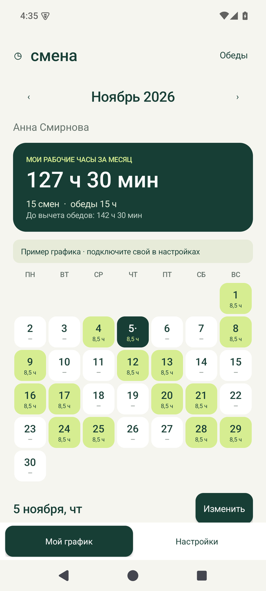
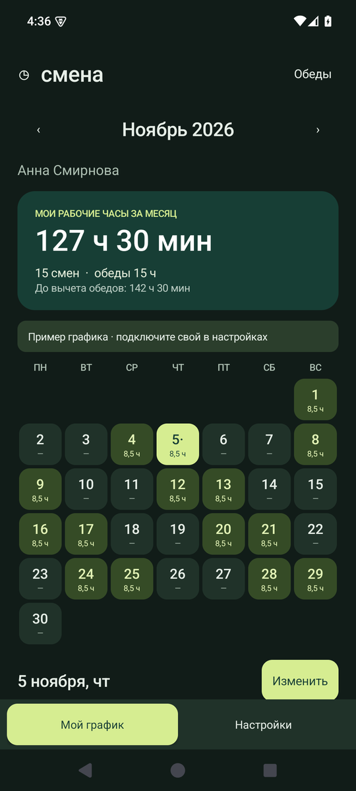

# Смена — личный график на Android

Лёгкое нативное приложение на Java, без сторонних библиотек в установленном приложении. Android 8.0 и новее. Интерфейс на русском.

 

## Возможности

Версия 1.1: выбор даты без скачков экрана, обновление жестом вниз, светлая/тёмная тема и полный сброс графика к актуальной таблице.

- Личный календарь, рабочие часы и сумма обедов за выбранный месяц.
- Загрузка из Google Таблиц / HTTPS CSV или импорт CSV-файла с телефона.
- Выбор себя в таблице, если в ней несколько сотрудников. Общего экрана команды нет.
- Добавление, редактирование, удаление смен **только на телефоне**; исходная таблица не изменяется.
- Локальные правки сохраняются поверх обновлённого источника; каждую можно отменить.
- График и настройки доступны после перезапуска без интернета.
- Настраиваемый расчёт обедов; ручной обед для каждой смены; ночные смены.
- Экспорт личного графика всех месяцев со всеми правками в CSV. В экспорт подставляются фактические минуты обеда, чтобы сохранить итоги.

На первом запуске публичная сборка показывает пример с вымышленным сотрудником. Подключите свою таблицу в приложении. Личные ссылки, фотографии и персональные APK не входят в публичный репозиторий.

## Установка

Установочный файл: `dist/smena-public.apk`. Скопируйте его на телефон, откройте и разрешите установку из выбранного файлового менеджера. Это локальная тестовая сборка, подписанная debug-ключом; для публикации нужна отдельная release-подпись.

## Подключение Google Таблиц

Чтобы подключить свою таблицу:

1. Создайте таблицу на https://sheets.new.
2. Выберите **Файл → Импорт → Загрузить**, укажите `templates/schedule.csv`. При импорте отключите преобразование текста в числа, даты и формулы, чтобы сохранить формат дат и времени. Для новых строк удобно задать столбцам формат «Обычный текст».
3. Замените примеры своими сменами. Не меняйте английские заголовки первой строки. Выходные — отсутствие строки на эту дату.
4. Для загрузки по ссылке нужен доступ на чтение без авторизации: **Настройки доступа → Все, у кого есть ссылка → Читатель**. В этом режиме любой обладатель ссылки сможет прочитать таблицу. Если нужен закрытый источник, оставьте доступ закрытым и скачивайте CSV для ручного импорта в приложение.
5. Скопируйте ссылку на нужный лист таблицы. В приложении откройте **Настройки**, вставьте ссылку и нажмите **Загрузить по ссылке**.
6. Проверьте число смен, выберите себя в таблице и подтвердите импорт. При обновлении локальные добавления, изменения и удаления сохраняются автоматически.

Обычная ссылка `https://docs.google.com/spreadsheets/d/ID/edit#gid=0` автоматически преобразуется в CSV-экспорт нужного листа. Поддерживается также опубликованный CSV (`/d/e/.../pub?output=csv`). Закрытые Google-таблицы через Google-вход в этой версии не подключаются. Google-документ с текстом не подходит — нужна именно таблица Sheets.

Для обновления прокрутите календарь в начало и потяните экран вниз до надписи «Отпустите, чтобы обновить». Также доступна кнопка «Загрузить по ссылке» в настройках. Обновление того же источника не требует подтверждения. При отсутствии интернета, HTML вместо CSV или ошибке строки текущий график остаётся на телефоне. Перед подключением нового источника приложение показывает число смен и выбор сотрудника. Локальные правки всегда сохраняются; их удаление вынесено в отдельный полный сброс.

## Настройки и сброс

«Настройки → Тёмная тема» переключает оформление календаря, карточек, полей ввода и диалогов. Выбор сохраняется после перезапуска.

«Настройки → Сбросить график к таблице» сначала скачивает и проверяет актуальный источник. После успешной загрузки удаляются **все** локальные добавления, изменения и удаления во всех месяцах, а правило автоматических обедов возвращается к 30/60 минут с порогом 8 часов. При сетевой ошибке данные остаются прежними. Сотрудник, ссылка и тема сохраняются. Для сброса нужна подключённая ссылка: импортированный с телефона CSV автоматически из Google не обновляется.

Обычное обновление всегда оставляет локально изменённые смены приоритетными, даже если в таблице появилась смена на дату локального добавления. Нетронутые смены обновляются, добавляются и удаляются вслед за источником.

## Структура CSV

| Столбец | Пример | Значение |
|---|---|---|
| `employee` | Анна Смирнова | Обязательно; постоянное уникальное имя сотрудника |
| `department` | Торговый зал | Необязательно; отдел |
| `date` | 2026-11-05 | Обязательно; дата начала. Допустимо 05.11.2026 |
| `start` | 09:30 | Обязательно; время начала |
| `end` | 19:00 | Обязательно; время конца |
| `break_minutes` | 60 | Необязательно; пусто = автоматический расчёт, 0 = без обеда |
| `next_day` | false | Необязательно; true/1 — конец на следующий день, false/0/пусто — в тот же день |

UTF-8, разделитель запятая или точка с запятой; кавычки CSV поддерживаются. Не более 2 МБ и 10 000 смен. Одна смена сотрудника на дату. Имена должны быть уникальны: однофамильцев различайте полным именем или добавляйте табельный номер. Переименование в источнике считается другим сотрудником.

Импорт заменяет **весь исходный набор**, а не только открытый месяц. Чтобы хранить историю, держите все нужные месяцы на одном листе CSV. Локальные правки связываются с точным именем и датой; при обновлении имеют приоритет над источником. Удалённая локально смена не появляется снова после обновления. Для возврата к источнику: «Настройки → Посмотреть и отменить правки».

## Расчёт обедов

Предварительно: смена **менее 8 ч → обед 30 мин**, **от 8 ч → 60 мин**. Месячные рабочие часы уже уменьшены на обеды. Обоснование по фотографии и ограничения вывода: [docs/hours-from-photo.md](docs/hours-from-photo.md).

Правило меняется кнопкой «Обеды»; явно заданный обед имеет приоритет. Ночная смена целиком учитывается в месяце её начала. В карточке итога часы и минуты точные; компактные подписи календаря округлены до 0,1 часа.

## Сборка и проверка

Нужны JDK 17 или 21 и Android SDK с платформой 36. Gradle 8.13 загружается wrapper-скриптом. Задайте `ANDROID_HOME` либо `sdk.dir` в локальном `local.properties`.

```powershell
$env:JAVA_HOME = 'C:\Program Files\Java\jdk-21'
$env:ANDROID_HOME = 'D:\Android\sdk'
.\gradlew.bat :app:assembleDebug :app:testDebugUnitTest :app:lintDebug -PpublicBuild=true
```

APK после сборки: `app/build/outputs/apk/debug/app-debug.apk`.

Проверка настоящего Android-хранилища на запущенном эмуляторе или подключённом тестовом устройстве:

```powershell
.\gradlew.bat :app:assembleDebugAndroidTest
adb install -r app/build/outputs/apk/debug/app-debug.apk
adb install -r app/build/outputs/apk/androidTest/debug/app-debug-androidTest.apk
adb shell am instrument -w ru.smena.app.test/ru.smena.app.StoreInstrumentation
```

Основные классы: `Schedule` — расчёт и слияние правок; `CsvSchedule` — проверка CSV; `GoogleSource` — HTTPS-загрузка; `ScheduleStore` — атомарное локальное хранение; `MainActivity` — интерфейс.

Внешний сервис не получает локальные правки; APK не содержит аналитики, рекламы и ключей Google. Приложение обращается только к указанному источнику и его HTTPS-перенаправлениям. Экспортируйте график перед удалением приложения: локальные данные удаляются вместе с ним.

## Личная сборка

Скопируйте smena.local.properties.example в smena.local.properties, задайте sourceUrl и employee. Файл исключён из Git. Обычная сборка использует эти значения; -PpublicBuild=true всегда собирает APK без личной ссылки и имени.
